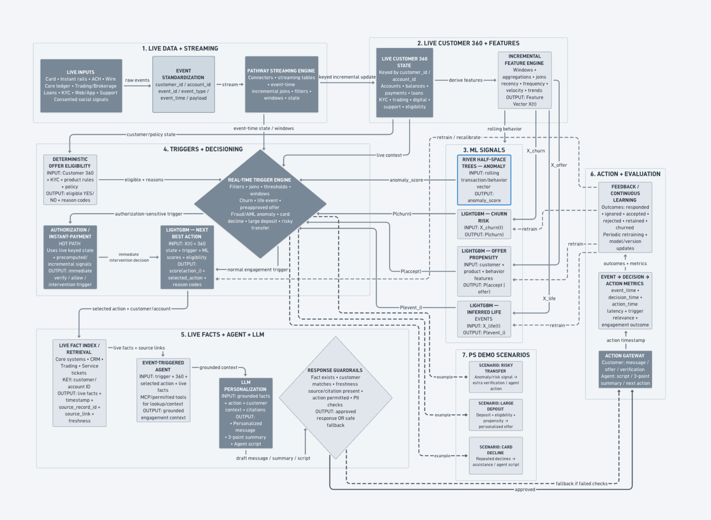

# Real-Time Financial Agents

**Streaming Customer 360 and next-best-action system on Pathway | Inter IIT Tech Meet 15.0 Internal Selection**

A prototype financial-services pipeline that processes simulated financial events, maintains incremental customer state, generates streaming ML signals, evaluates deterministic triggers, ranks candidate actions, and produces grounded, guardrailed engagement messages.

> **Implementation status:** This repository contains an architecture design and a runnable prototype built around simulated events. The LightGBM models use synthetic labels, and the measured event-to-action latency is from local simulation/replay. Neither should be interpreted as real-world model performance or production-system latency.

## System architecture

The diagram below shows the intended end-to-end system, including the streaming data path, Customer 360 feature layer, ML signals, deterministic decisioning, agent/LLM layer, safety checks, action gateway, and feedback loop.



The editable Mermaid source is available at [`docs/architecture.mmd`](docs/architecture.mmd).

## How the system works

1. **Live event ingestion and standardization** — accepts card, deposit, transfer, login, and other event-shaped records; canonicalizes event types. The current demo uses a Pathway Python connector that replays simulated events.
2. **Streaming Customer 360** — incrementally aggregates per-customer activity, computes event-time sliding-window features, and joins customer profile attributes.
3. **Streaming ML signals** — River HalfSpaceTrees produces an online anomaly score. LightGBM provides churn-risk, offer-propensity, and inferred-life-event probabilities; these three classifiers are currently trained on synthetic labels.
4. **Deterministic triggers and eligibility** — rule-based trigger conditions and eligibility checks produce explicit reason codes. Authorization-sensitive cases are prioritized before engagement actions.
5. **Next-best-action ranking** — scores eligible candidate actions using a transparent expected-utility heuristic. This is not a trained ranking model.
6. **Grounded agent and personalization** — retrieves source-linked event facts, applies action-specific policy text, and creates a template-based message (with optional LLM phrasing).
7. **Guardrails and action gateway** — checks message grounding, cited event references, allowed actions, and PII patterns; records action status and event-to-action timing. A kill switch can suppress actions.
8. **Evaluation and feedback** — records event, decision, and action information. A complete outcome-label-retraining loop remains future work.

## Technology stack

- **Pathway:** incremental streaming tables, joins, reducers, event-time windows, Python connector, subscriptions
- **River:** online anomaly scoring with HalfSpaceTrees
- **LightGBM:** tabular classifiers for churn, offer propensity, and inferred life-event signals
- **Python / NumPy / scikit-learn:** feature processing and synthetic model-training pipeline
- **MCP:** optional read-only tools for inspecting recorded decisions, actions, and metrics
- **pytest:** unit and scenario tests

## Repository structure

```text
.
├── data/
│   ├── customers.csv
│   └── policies/                 # Demo action/policy text
├── docs/
│   ├── architecture.png          # End-to-end architecture diagram
│   ├── architecture.mmd          # Editable Mermaid diagram
│   ├── ARCHITECTURE.md            # Component-to-code mapping
│   ├── PROJECT_STATUS.md          # Implemented vs planned capabilities
│   ├── MODEL_CARD.md              # Model/data/metric limitations
│   └── ROADMAP.md                 # Work required for real-data validation
├── models/                        # Locally generated LightGBM model files
├── out/                            # Runtime audit logs and metrics
├── src/fa/
│   ├── pipeline.py                # Pathway event, Customer 360 and feature pipeline
│   ├── ml.py                      # River anomaly + LightGBM signals
│   ├── decisioning.py             # Eligibility, triggers and action scoring
│   ├── simulator.py               # Synthetic event stream and scenarios
│   ├── agent.py                   # Permissioned tool orchestration and trace
│   ├── personalize.py             # Policy-aware response generation
│   ├── guardrails.py              # Grounding, citation, action and PII checks
│   ├── gateway.py                 # Idempotency, audit records and latency
│   ├── mcp_server.py              # Optional read-only MCP interface
│   └── run.py                     # CLI entry point
├── tests/
│   ├── test_core.py
│   └── test_scenarios.py
├── requirements.txt
├── Makefile
└── Dockerfile
```

## Quickstart

### 1. Create and activate an environment

Python 3.11 is the version used by the included Dockerfile. Python 3.10–3.12 may work depending on platform/package wheel availability.

**macOS / Linux (venv):**

```bash
python3.11 -m venv .venv
source .venv/bin/activate
python -m pip install --upgrade pip
```

**Windows (PowerShell):**

```powershell
py -3.11 -m venv .venv
.venv\Scripts\Activate.ps1
python -m pip install --upgrade pip
```

### 2. Install dependencies

```bash
pip install -r requirements.txt
```

If Pathway cannot be installed on your host OS, use the Docker route below; Pathway's platform support can differ from the other Python packages.

### 3. Train the demo classifiers and run the stream

```bash
make train
make demo
```

`make train` generates LightGBM models from synthetic data. `make demo` replays the scripted scenarios and writes output files under `out/`, including:

- `actions.jsonl` — per-customer decision/action audit records
- `metrics.json` — run-level event-to-action timing summary
- `minute_metrics.jsonl` — event-time window metrics

### 4. Run tests

```bash
make test
```

Do not treat the tests as passing unless this command completes successfully in your environment.

### 5. Optional Docker run

```bash
docker build -t real-time-financial-agents .
docker run --rm real-time-financial-agents
```

The Docker image uses Python 3.11 and installs dependencies from `requirements.txt`.

## Demo scenarios

The event simulator includes three scripted cases:

| Scenario | Synthetic customer | Intended response |
|---|---|---|
| Risky transfer | `C9001` | Extra verification |
| Large deposit | `C9002` | Eligibility check followed by a possible savings/loan offer |
| Repeated card declines | `C9003` | Assistance workflow |

These are synthetic fixtures, not real customers or confirmed fraud events.

## Evaluation and interpretation

The gateway records event, decision, and action timestamps and derives event-to-action timing during a local replay. Treat these values as **prototype instrumentation results for the specific machine, replay speed, and simulated workload**. They are not a production benchmark or a service-level guarantee.

The three LightGBM models are trained on synthetic labels generated by hand-written probability functions. Their metrics only check that the training/inference path is wired up; they do not establish predictive performance on real financial data.

## Limitations and responsible use

- No live bank, card, ACH, wire, trading, KYC, CRM, or support provider is connected.
- The current data stream and customer profiles are simulated.
- Churn, offer-propensity, and inferred-life-event LightGBM models use synthetic labels.
- River anomaly scoring learns online from the simulated event stream; it has not been validated on real financial transactions.
- Next-best-action uses heuristic expected-utility scoring, not a trained ranker.
- The fact index is a keyed source-linked event store, not a semantic/vector database.
- Feedback capture and outcome-driven retraining are not implemented end-to-end.
- Guardrails are prototype checks, not a compliance, privacy, or security certification.
- This project is a research/demo prototype and must not be used to make live credit, fraud, AML, transaction authorization, or customer eligibility decisions.

See [`docs/PROJECT_STATUS.md`](docs/PROJECT_STATUS.md), [`docs/MODEL_CARD.md`](docs/MODEL_CARD.md), and [`docs/ROADMAP.md`](docs/ROADMAP.md) for details.

## Resume alignment

This repository supports describing the work as **architecture design and prototype implementation**: streaming Customer 360, Pathway incremental processing, River online anomaly scoring, synthetic-data LightGBM signal integration, deterministic trigger/eligibility logic, heuristic next-best-action, grounded agent workflows, guardrails, MCP inspection tools, and local event-to-action instrumentation.

Only claim modules you can personally explain and demonstrate. In particular, qualify all ML and latency results as synthetic/local prototype measurements.
